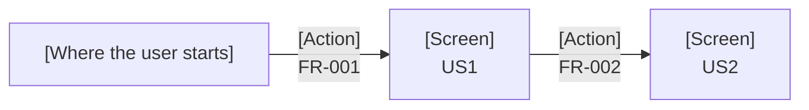
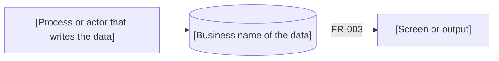
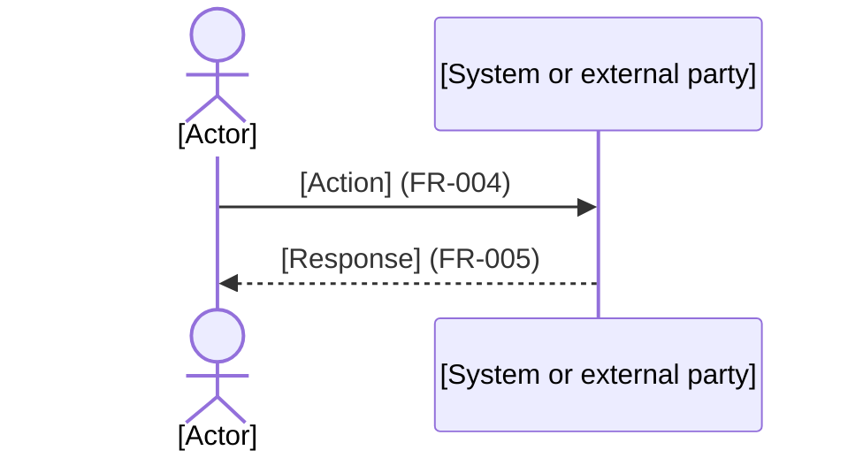
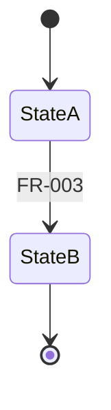

# Feature Specification: [FEATURE NAME]

**Feature Branch**: `[###-feature-name]`

**Created**: [DATE]

**Status**: Draft

**Input**: User description: "$ARGUMENTS"

<!--
  This template comes from the spec-review-layout preset.
  Before filling any section, read .specify/presets/spec-review-layout/rules/spec-layout.md
  and follow it for every section, including the Review Layout checks in its section 8.
  Where it conflicts with formatting guidance in the command, follow the rules file.
  Remove every HTML comment from spec.md when done.
-->

## Overview Map *(mandatory)*

<!--
  Keep the diagrams that fit this feature and delete the others (keep at least one).
  Labels carry names and IDs (US, FR) only. Conditions and values belong in the FRs.
  Keep "Screen layout" only when the feature has a screen.
  The Lifecycle diagram uses the same states as the state × action table under the FRs.
-->

**Screen flow**

**Data sources**

**Interactions**

**Lifecycle of [entity]**

**Screen layout**: [Screen] (top to bottom)

| Region | Contents | FR |
|---|---|---|
| [Region] | • [Field or button] • [Field or button] | FR-001 |
| [Region] | • [Field or button] | FR-002 |

## User Scenarios & Testing *(mandatory)*

<!--
  IMPORTANT: User stories should be PRIORITIZED as user journeys ordered by importance.
  Each user story/journey must be INDEPENDENTLY TESTABLE - meaning if you implement just ONE of them,
  you should still have a viable MVP (Minimum Viable Product) that delivers value.

  Assign priorities (P1, P2, P3, etc.) to each story, where P1 is the most critical.
  Think of each story as a standalone slice of functionality that can be:
  - Developed independently
  - Tested independently
  - Deployed independently
  - Demonstrated to users independently
-->

### User Story 1 - [Brief Title] (Priority: P1)

[Describe this user journey in plain language]

**Why this priority**: [Explain the value and why it has this priority level]

**Independent Test**:

- Setup: [Data or state to prepare]
- Action: [What the tester does]
- Check: [What the tester confirms]

**Acceptance Scenarios**:

| # | Given | When | Then | Refs |
|---|---|---|---|---|
| 1 | [One statement of the starting state] | [One action] | • [Outcome to check] • [Outcome to check] | • FR-001 • FR-002 |
| 2 | [One statement of the starting state] | [One event, e.g. the network disconnects] | • [Outcome to check] | FR-003 |

**Example data US1-1**

| [Field] | [Field] | [Order shown] |
|---|---|---|
| [Value] | [Value] | 1 |
| [Value] | [Value] | 2 |

---

### User Story 2 - [Brief Title] (Priority: P2)

[Describe this user journey in plain language]

**Why this priority**: [Explain the value and why it has this priority level]

**Independent Test**:

- Setup: [Data or state to prepare]
- Action: [What the tester does]
- Check: [What the tester confirms]

**Acceptance Scenarios**:

| # | Given | When | Then | Refs |
|---|---|---|---|---|
| 1 | [One statement of the starting state] | [One action] | • [Outcome to check] | FR-004 |

---

### User Story 3 - [Brief Title] (Priority: P3)

[Describe this user journey in plain language]

**Why this priority**: [Explain the value and why it has this priority level]

**Independent Test**:

- Setup: [Data or state to prepare]
- Action: [What the tester does]
- Check: [What the tester confirms]

**Acceptance Scenarios**:

| # | Given | When | Then | Refs |
|---|---|---|---|---|
| 1 | [One statement of the starting state] | [One action] | • [Outcome to check] | FR-005 |

---

[Add more user stories as needed, each with an assigned priority]

### Edge Cases

<!--
  One row per case. Add new cases as rows, not as bullets.
-->

| Case | Outcome | Refs |
|---|---|---|
| [Boundary condition] | [What happens, with values or exact messages] | FR-001 |
| [Error input or failure] | [What happens, with values or exact messages] | FR-002 |

## Requirements *(mandatory)*

<!--
  ACTION REQUIRED: The content in this section represents placeholders.
  Fill them out with the right functional requirements.
  Keep the "- **FR-###**:" line form. Put details as "**Label**:" child bullets,
  and condition or state tables directly under the FR they belong to.
  When an FR has both, the table comes first and the child bullets follow it.
-->

### Functional Requirements

- **FR-001**: [System MUST do what, in one or two sentences]
  - **[Label]**: [One rule for one situation]
  - **[Label]**: [One rule for one situation]
- **FR-002**: [System MUST do what, as shown in the table below]

  | [Condition] | [Condition] | [Result] |
  |---|---|---|
  | [Value] | [Value] | [What happens] |
  | [Value] | [Value] | [What happens] |
  | [Value] | [Value] | — (cannot occur) |

  - **[Label]**: [One rule that applies to the table above]
- **FR-003**: [System MUST move the entity between states as shown in the table below]

  | State ↓ / Action → | [User action] | [Event] |
  |---|---|---|
  | [State] | → [New state] | — (cannot occur) |
  | [State] | — (not allowed) | → [New state] |

- **FR-004**: [Users MUST be able to do what]
  - **[Label]**: [One rule for one situation]

*Example of marking unclear requirements:*

- **FR-005**: [System MUST authenticate users via] [NEEDS CLARIFICATION: auth method not specified - email/password, SSO, OAuth?]

### Key Entities *(include if feature involves data)*

| Entity | One record is | Attributes | Used by |
|---|---|---|---|
| **[Entity 1]** | [What one record represents] | • [Attribute] • [Attribute] | • FR-001 (read) • FR-002 (write) |
| **[Entity 2]** | [What one record represents] | • [Attribute] | FR-003 (read) |

## Success Criteria *(mandatory)*

<!--
  ACTION REQUIRED: Define measurable success criteria.
  These must be technology-agnostic and measurable.
-->

### Measurable Outcomes

- **SC-001**: [Measurable metric, e.g., "Users can complete account creation in under 2 minutes"]
- **SC-002**: [Measurable metric, e.g., "System handles 1000 concurrent users without degradation"]
- **SC-003**: [User satisfaction metric, e.g., "90% of users successfully complete primary task on first attempt"]
- **SC-004**: [Business metric, e.g., "Reduce support tickets related to [X] by 50%"]

## Assumptions

<!--
  ACTION REQUIRED: The content in this section represents placeholders.
  Fill them out with the right assumptions based on reasonable defaults
  chosen when the feature description did not specify certain details.
-->

- [Assumption about target users, e.g., "Users have stable internet connectivity"]
- [Assumption about scope boundaries, e.g., "Mobile support is out of scope for v1"]
- [Assumption about data/environment, e.g., "Existing authentication system will be reused"]
- [Dependency on existing system/service, e.g., "Requires access to the existing user profile API"]
